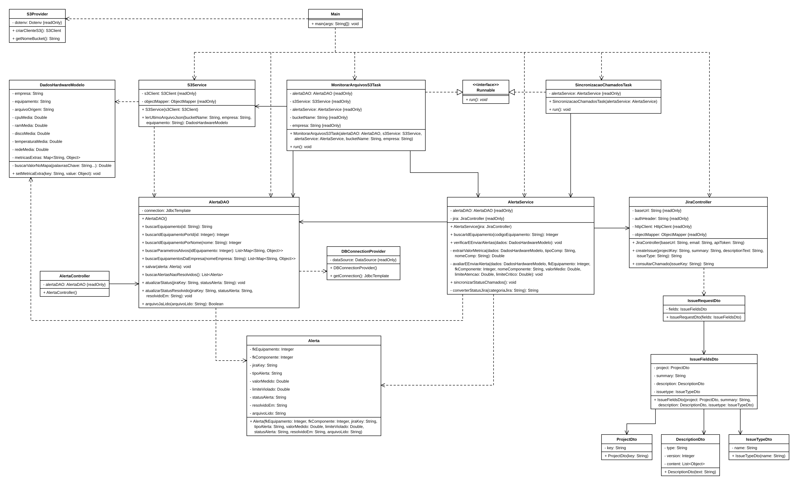

# InfraWatch-IntegracaoJava

Sistema Java puro para monitorar equipamentos, consultar arquivos JSON no S3, comparar metricas com limites cadastrados no MySQL e abrir chamados no Jira quando necessario.

Nao ha Spring Boot. O projeto usa `JdbcTemplate` para banco, AWS SDK v2 para S3, Jackson para leitura de JSON, `HttpClient` para o Jira e `dotenv-java` para configuracao externa.

## Objetivo

Detectar quando um equipamento ultrapassa os limites de alerta configurados para seus componentes, registrar o chamado no Jira e manter o historico sincronizado com o banco.

## Diagrama



## Estrutura

### `Main`
Ponto de entrada da aplicacao. Ele cria as dependencias, agenda as rotinas e mantem a aplicacao em execucao.

### `config`
- `S3Provider`: cria o cliente AWS S3 com as credenciais do `.env`.
- `DBConnectionProvider`: monta o `JdbcTemplate` usado pelos DAO.

### `service`
- `S3Service`: localiza o JSON mais recente de um equipamento, baixa o arquivo e converte para `DadosHardwareModelo`.
- `AlertaService`: concentra a regra de negocio do alerta, cria issues no Jira, persiste o chamado e sincroniza o status com o banco.
- `MonitorarArquivosS3Task`: varre todos os equipamentos da empresa no S3 e dispara o processamento de alertas.
- `SincronizacaoChamadosTask`: consulta periodicamente o Jira para atualizar os status dos chamados no banco.

### `controller`
- `JiraController`: faz a comunicacao com a API do Jira para criar e consultar issues.
- `AlertaController`: existe como apoio, mas nao faz parte do fluxo principal atual.

### `dao`
- `AlertaDAO`: executa consultas SQL sobre alertas, parametros, equipamentos e controle de arquivos ja processados.

### `model`
- `DadosHardwareModelo`: representa o JSON lido do S3.
- `Alerta`: representa o alerta consolidado que sera persistido no banco.

### `dto`
Objetos usados para montar o payload enviado ao Jira:
- `ProjectDto`
- `IssueTypeDto`
- `IssueRequestDto`
- `IssueFieldsDto`
- `DescriptionDto`

## Fluxo atual

### 1. Inicializacao
`Main.main()` carrega o `.env`, cria o cliente do S3, instancia o `S3Service`, o `JiraController`, o `AlertaService` e o `AlertaDAO`.

Depois disso, ele cria um `ScheduledExecutorService` com duas threads e agenda duas rotinas em paralelo:
- varredura do S3 por equipamento;
- sincronizacao de status dos chamados no Jira.

### 2. Varredura do S3
`MonitorarArquivosS3Task` busca todos os equipamentos da empresa no banco e percorre cada `idEquipamento` separadamente.

Para cada equipamento, o `S3Service` procura o ultimo JSON no caminho:

```text
gold/{empresa}/{idEquipamento}/
```

Se nao existir arquivo novo, a task segue para o proximo equipamento. Se houver JSON valido, o conteudo e convertido para `DadosHardwareModelo` e enviado para o `AlertaService`.

### 3. Tratamento do alerta
`AlertaService.verificarEEnviarAlertas(...)` identifica o equipamento, busca os parametros ativos no banco e cruza cada componente monitorado com a metrica correspondente no JSON.

O modelo aceita nomes alternativos para as metricas, como CPU, Processador, RAM, Memoria, Disco, Armazenamento e similares.

### 4. Classificacao
Quando existe valor medido, o service compara com os limites cadastrados:

- valor maior ou igual ao limite critico: alerta `CRITICO`;
- valor maior ou igual ao limite de atencao: alerta `ATENCAO`;
- abaixo dos limites: nada e enviado ao Jira.

### 5. Criacao do chamado
Quando ha violacao de limite, o `JiraController` monta o payload da issue e envia a requisicao de criacao.

A descricao e enviada no formato ADF exigido pela API v3 do Jira.

### 6. Persistencia e deduplicacao
A resposta do Jira retorna a `key` da issue criada. O alerta e persistido no banco com:

- `jiraKey`
- `fkEquipamento`
- `fkComponente`
- `tipoAlerta`
- `valorMedido`
- `limiteViolado`
- `statusAlerta`
- `resolvidoEm`
- `arquivoLido`

O campo `arquivoLido` evita que o mesmo JSON seja processado duas vezes.

### 7. Sincronizacao de status
`SincronizacaoChamadosTask` roda periodicamente e chama o service para consultar as issues abertas no Jira.

Quando o status muda para concluido, a aplicacao atualiza o banco com o status `Concluído` e preenche `resolvidoEm` internamente, sem depender da data vinda do Jira.

## Classes principais

### `school.sptech.Main`
Coordena a inicializacao e o agendamento das tasks.

### `school.sptech.service.S3Service`
Localiza o arquivo mais recente no S3 e converte o JSON para objeto Java.

### `school.sptech.service.MonitorarArquivosS3Task`
Percorre os equipamentos da empresa e dispara o fluxo de alerta.

### `school.sptech.service.SincronizacaoChamadosTask`
Dispara a rotina de sincronizacao com o Jira.

### `school.sptech.service.AlertaService`
Aplica as regras de negocio e integra S3, MySQL e Jira.

### `school.sptech.dao.AlertaDAO`
Executa as consultas SQL usadas pelo fluxo.

### `school.sptech.controller.JiraController`
Monta e envia as requisicoes HTTP para o Jira.

### `school.sptech.model.DadosHardwareModelo`
Modela os dados lidos do JSON e tolera variacoes de nome nas metricas.

### `school.sptech.model.Alerta`
Transporta os dados do chamado consolidado para persistencia.

### `school.sptech.dto.*`
Estruturam o payload esperado pelo Jira.

## Variaveis de ambiente

O projeto usa `dotenv-java` para carregar configuracoes do arquivo `.env`.

Variaveis usadas no codigo atual:

- `AWS_ACCESS_KEY_ID`
- `AWS_SECRET_ACCESS_KEY`
- `AWS_SESSION_TOKEN`
- `AWS_REGION`
- `AWS_BUCKET_NAME`
- `DB_URL`
- `DB_USUARIO`
- `DB_SENHA`
- `JIRA_BASE_URL`
- `JIRA_EMAIL`
- `JIRA_API_TOKEN`

## Observacoes

- O fluxo principal esta concentrado em `Main`, nao em Spring Boot.
- O processamento do S3 agora percorre todos os equipamentos da empresa, usando `idEquipamento` como pasta no bucket.
- O projeto permanece simples, sem container de injeccao de dependencia.

## Tecnologias

- Java 21
- Maven
- Spring JDBC
- Apache Commons DBCP2
- AWS SDK for Java v2
- Jackson
- dotenv-java
- MySQL
- Jira REST API
